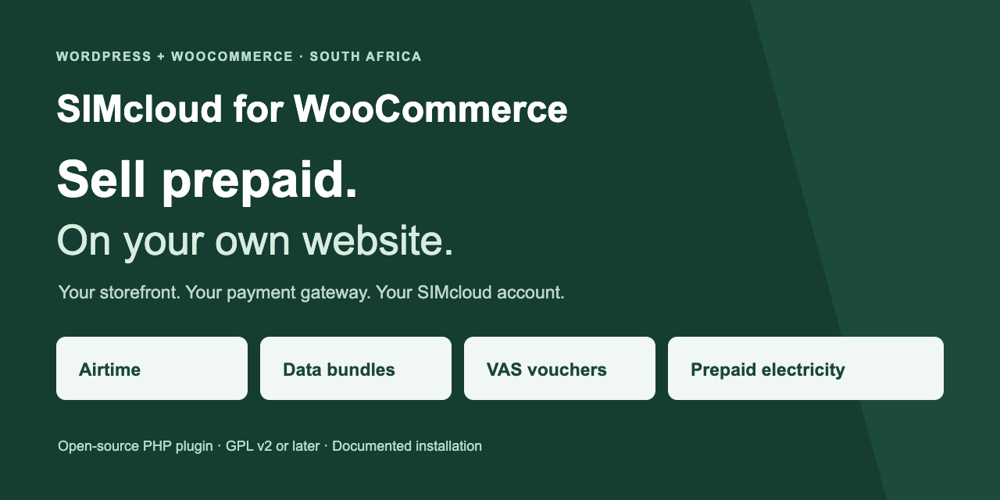
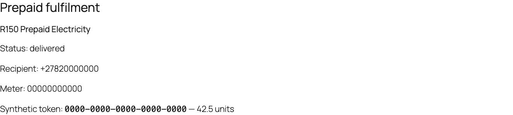

# SIMcloud for WooCommerce — WordPress airtime, data, vouchers and electricity plugin



Sell South African **airtime, data bundles, VAS vouchers and prepaid electricity** from your WordPress website. WooCommerce handles your shop, checkout and customer payments; the plugin sends eligible paid orders to the [SIMcloud API](https://simcloud.co.za/api/) and shows delivery in the customer's order details.

[](https://github.com/ErikThiart/simcloud-woocommerce/actions/workflows/plugin.yml) [](https://github.com/ErikThiart/simcloud-woocommerce/actions/workflows/docs.yml) [](LICENSE)

**[Download v0.2.0 ZIP](https://github.com/ErikThiart/simcloud-woocommerce/releases/download/v0.2.0/simcloud-woocommerce-0.2.0.zip)** · **[Install with screenshots](docs/installation.md)** · **[See the plugin](docs/screenshots.md)** · **[Browse all documentation](docs/README.md)**

**Release status:** v0.2.0 is an installable **prerelease**. Automated tests and browser checks use real WordPress/WooCommerce with synthetic SIMcloud responses. Live supplier delivery has not been verified by this project. Complete a controlled acceptance purchase with your own SIMcloud account before opening production sales. [Read the verification evidence](docs/verification.md).

## What can I sell?

| Service | What you configure | What the customer receives |
| --- | --- | --- |
| **Airtime** | Mobile network and provider amount, R2–R999 | Recharge to a validated South African mobile number |
| **Data bundles** | Current catalogue product, network and exact provider amount | Selected bundle to the validated recipient |
| **VAS vouchers** | Current voucher catalogue product and available denomination | Voucher code(s) in authorized order details |
| **Prepaid electricity** | Whole-rand provider amount, R55–R1000 | Meter validation followed by token(s) and units in order details |

VAS means **value-added services**: the voucher products available to your SIMcloud account. Catalogue availability and denominations can change. Electricity's provider amount includes the SIMcloud fee and does not promise the same value in electricity units. You set the WooCommerce selling price separately from the amount sent to SIMcloud.

## Automatic data-bundle products

Click **WooCommerce → SIMcloud → Refresh catalogues / import data**. The plugin reads the product-list API and publishes missing data bundles with their names, networks, provider IDs and amounts already configured. The API amount becomes the initial WooCommerce regular retail price. Repeat imports preserve merchant edits and prices, and skip ambiguous bundles.

**[See the automatic product import guide and screenshots →](docs/data-product-import.md)**

## How it works

1. Import data bundles automatically, or create a simple product for airtime, VAS or electricity.
2. The customer supplies a recipient mobile number, and a meter number for electricity. VAS vouchers need neither.
3. Your payment gateway confirms payment through WooCommerce, or staff explicitly confirm received funds for an offline payment.
4. A background job submits each eligible prepaid line to SIMcloud and checks its delivery status.
5. The order completes when all prepaid lines have confirmed delivery. Voucher codes and electricity tokens appear in authorized order details.

The plugin supports **classic checkout, WooCommerce Checkout Blocks and High-Performance Order Storage (HPOS)**. It includes token settings, wallet diagnostics, catalogue refresh, a per-line fulfilment ledger, background jobs and staff status refresh. A missing or uncertain provider response goes to review without an automatic second purchase.

## Install in WordPress

You need WordPress **6.8.3+**, WooCommerce **10.0.4+**, PHP **8.2+**, HTTPS, a **ZAR** store, working scheduled jobs, and your own funded SIMcloud account/API token. These are minimum requirements; the [tested version matrix](docs/verification.md) records the combinations actually checked.

1. Download **`simcloud-woocommerce-0.2.0.zip`** from [Releases](https://github.com/ErikThiart/simcloud-woocommerce/releases/tag/v0.2.0). Choose the installable asset, rather than GitHub's source archive.
2. In WordPress, open **Plugins → Add New Plugin → Upload Plugin**, select the ZIP, install and activate it.
3. Open **WooCommerce → SIMcloud**, save your token and check the connection.
4. Click **Refresh catalogues / import data** to populate data products, [configure the other services](docs/product-setup.md), and set allowed payment gateway IDs.
5. Read the acceptance and recovery instructions before enabling live submissions. They start disabled.

**[Follow the complete illustrated installation guide →](docs/installation.md)**


## See what customers receive

This is an actual WooCommerce order view from the local demonstration store. The token and units are synthetic; no electricity was purchased. The [screenshot gallery](docs/screenshots.md) also shows mobile-number entry, meter entry, Checkout Blocks, staff funds confirmation and VAS delivery.



## Payments, delivery and recovery

Customer payments go through **your WooCommerce payment gateway**. The plugin does not collect payments or top up your SIMcloud wallet. Automatic fulfilment requires an explicitly allowed gateway that calls WooCommerce's `payment_complete` after authenticating payment. BACS, cheque and COD require authorized staff confirmation of actually received funds.

A payment receipt is separate from prepaid delivery. Refunds do not reverse a recharge or redeemable code. If a purchase times out after submission, preserve its reference and reconcile the original attempt. The plugin does not automatically repeat an uncertain purchase, issue refunds or offer a resubmit button. [Understand order states and recovery](docs/order-lifecycle.md).

The initial release supports virtual simple prepaid products with quantity one per recipient line. It excludes mixed prepaid/other baskets, variable products, subscriptions, network-wide activation, multi-currency, bulk order imports and customer wallets. [Read the FAQ](docs/faq.md).

## Documentation and help

| I want to… | Start here |
| --- | --- |
| Install the plugin | [Illustrated installation](docs/installation.md) |
| Automatically populate data bundles | [Data-product import](docs/data-product-import.md) |
| Set up airtime, data, VAS or electricity | [Product setup with screenshots](docs/product-setup.md) |
| Preview the admin and customer screens | [Screenshot gallery](docs/screenshots.md) |
| Fix a setup or delivery problem | [Troubleshooting](docs/troubleshooting.md) and [FAQ](docs/faq.md) |
| Run a store safely | [Merchant operations](docs/merchant-guide.md), [order recovery](docs/order-lifecycle.md), [security and privacy](docs/security-and-privacy.md) |
| Review the implementation | [Architecture](docs/architecture.md), [API contract](docs/api-contract.md), [product specification](docs/product-specification.md) |
| Test or contribute | [Testing](docs/testing.md), [verification evidence](docs/verification.md), [contributing](CONTRIBUTING.md) |
| Report a problem | [Support and reporting boundaries](SUPPORT.md), [private security reporting](SECURITY.md) |

See the [complete documentation index](docs/README.md), [changelog](CHANGELOG.md) and [roadmap](docs/roadmap.md). Plugin bugs and documentation corrections belong in [GitHub Issues](https://github.com/ErikThiart/simcloud-woocommerce/issues/new/choose). Account, wallet and private transaction investigations belong with SIMcloud support; do not publish customer details or credentials.

## For developers

The plugin uses procedural PHP and native WordPress, WooCommerce and Action Scheduler APIs. The deterministic package builder includes an explicit runtime allowlist; tests, documentation, credentials and logs are excluded from the installable ZIP.

```sh
git clone https://github.com/ErikThiart/simcloud-woocommerce.git
cd simcloud-woocommerce
python3 scripts/check_docs.py
# Requires an isolated local MySQL/MariaDB server; follow docs/testing.md first.
bash scripts/setup-tests.sh
bash scripts/test.sh
python3 scripts/package.py
```

The integration suite checks all four services with a real WooCommerce database and mocked HTTP transport, including checkout, payment authorization, concurrent workers and lifecycle changes. [See the test instructions and evidence](docs/testing.md).

## Open source

Copyright (C) 2026 Erik Thiart and contributors. Licensed under **GPL-2.0-or-later**. You may use, study, modify and redistribute the plugin under the [license](LICENSE); it is provided without warranty. Contributions follow the same license and our [code of conduct](CODE_OF_CONDUCT.md).

The free plugin does not include prepaid value, SIMcloud account services, payment processing fees or a commercial support contract. WordPress and WooCommerce belong to their respective projects; no endorsement or WordPress.org directory approval is claimed.
