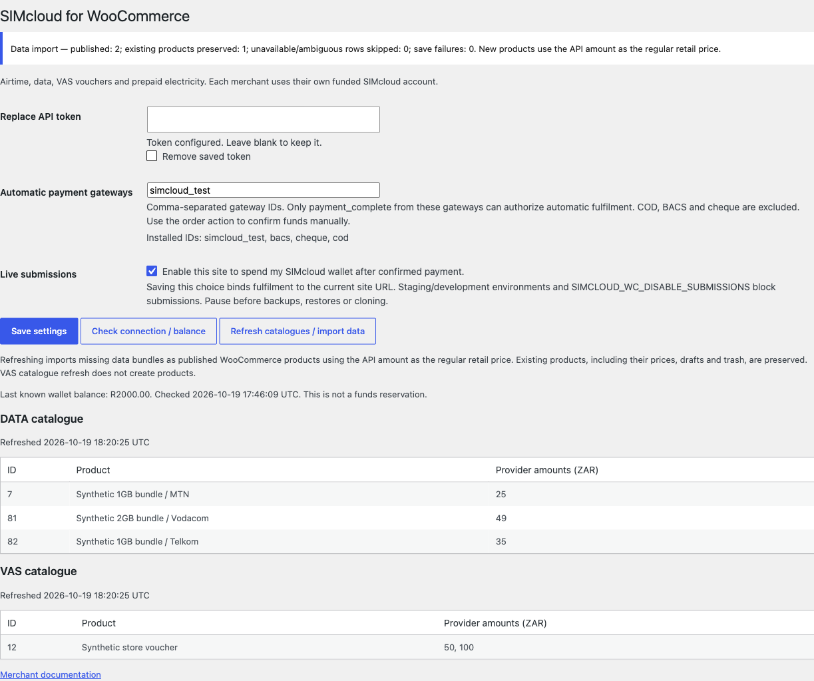
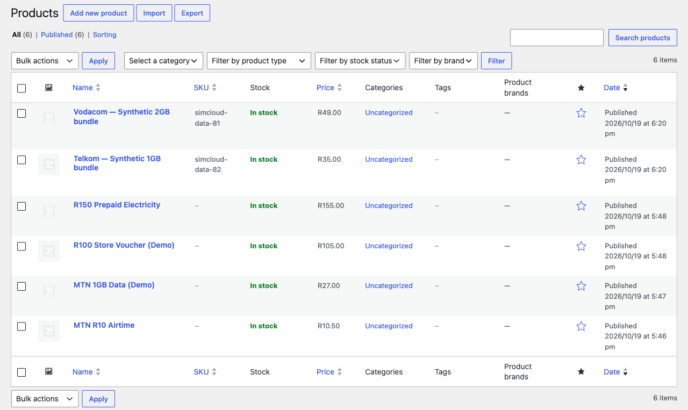
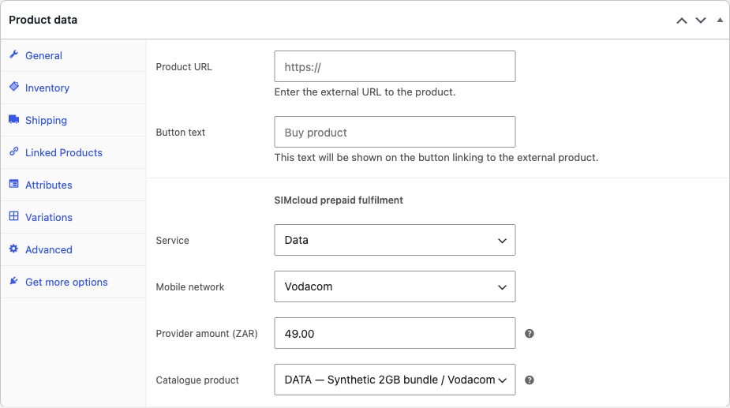

# Automatically populate WooCommerce data-bundle products

From **v0.2.0 (prerelease)**, the plugin uses SIMcloud's **product-list API** to create your WooCommerce data-bundle products automatically. You do not need to enter each bundle manually.

## Import the current data bundles

1. Install [v0.2.0](https://github.com/ErikThiart/simcloud-woocommerce/releases/tag/v0.2.0), use a **ZAR** store and save your own SIMcloud API token.
2. Open **WooCommerce → SIMcloud** as a user with WooCommerce management and product-editing permissions.
3. Click **Refresh catalogues / import data**. The plugin fetches the current data catalogue and refreshes VAS catalogue choices.
4. Read the result: how many products were published, already existed, were skipped or failed to save.
5. Open **Products → All Products** to review the newly published data bundles.

The import uses `GET /api/data.php?products=1`. It does not submit a recharge or spend wallet funds. You can import products while live submissions are disabled. Customers can purchase them only after the normal connection, payment and live-submission requirements are met.

## What is populated automatically?

| WooCommerce field | Source / behaviour |
| --- | --- |
| Product name | Network label and API bundle description |
| Description | API bundle description |
| Short description | API product group (`groupname`) |
| Product type | Simple, virtual, non-downloadable |
| Publication state | Published |
| Regular retail price | Exact API `amount`, in ZAR, with no plugin markup |
| SIMcloud service | Data |
| Mobile network | Normalized API network |
| Provider amount | Exact API `amount` |
| Catalogue product | API `product_id` |
| Initial SKU | `simcloud-data-` followed by the API product ID |

The retail price and provider amount are separate fields even when initially equal. Merchants can change their WooCommerce selling price afterwards. Coupons and taxes follow the store's WooCommerce configuration; they do not change the provider denomination. Review tax settings and commercial terms for your store.

## What happens when I refresh again?

Existing products are preserved. The importer recognizes both previously imported products and manually configured data products with the same provider product ID. It does not overwrite names, descriptions, SKUs, regular/sale prices, service configuration or publication state. Drafts stay drafts; trashed products are not restored. An import marker also prevents recreating an imported product after its prepaid configuration is removed.

A refresh creates missing products; it is not a scheduled catalogue mirror. It does not reprice, unpublish or delete existing products when the API changes. Review changed bundles in the catalogue and update their settings deliberately. Existing paid orders continue to use their saved purchase snapshots, and checkout/submission still validate the selected bundle against the current API catalogue.

## Skipped products and failures

The current data-order API selects bundles by **network plus amount**, rather than product ID. If multiple catalogue products share that combination, the importer skips them instead of publishing indistinguishable offers. Duplicate IDs, invalid amounts, unsupported networks and missing descriptions are also skipped.

A concurrent refresh is rejected while another import holds the database lock. Product-save failures are counted in the result and logged under **WooCommerce → Status → Logs → `simcloud-woocommerce`** with the provider product ID. Resolve the cause, then refresh again; successfully imported products are retained and not duplicated. A conflicting existing SKU is a save failure, not permission to overwrite an unrelated product.

An empty catalogue never removes products. A failed API read imports nothing. VAS refresh still populates catalogue choices only; airtime, VAS and electricity products retain their [existing setup flow](product-setup.md).

**Screenshot context:** actual v0.2.0 WordPress/WooCommerce screens with intercepted API transport and synthetic catalogue items, captured 19 October 2026. Names and prices illustrate the import; they are not current provider offers. No live prepaid purchase was made.

[← Installation](installation.md) · [Product setup](product-setup.md) · [Troubleshooting](troubleshooting.md) · [Documentation index](README.md)
