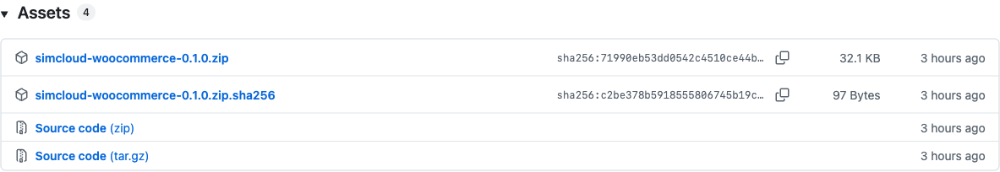
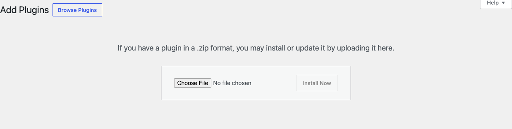
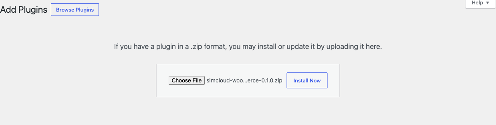
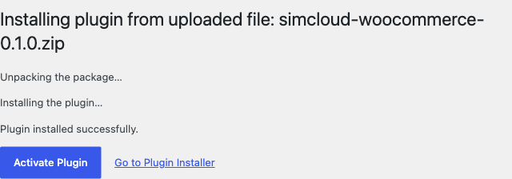
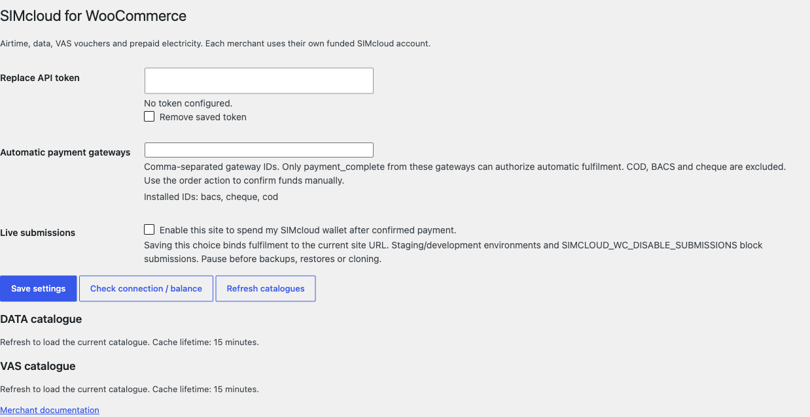
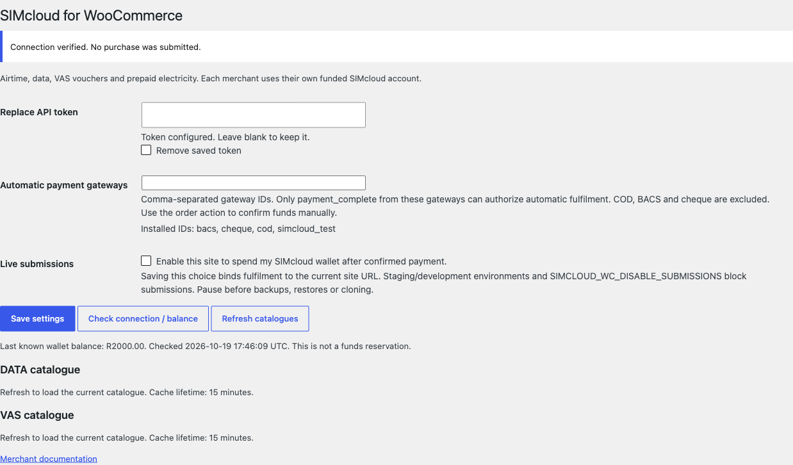
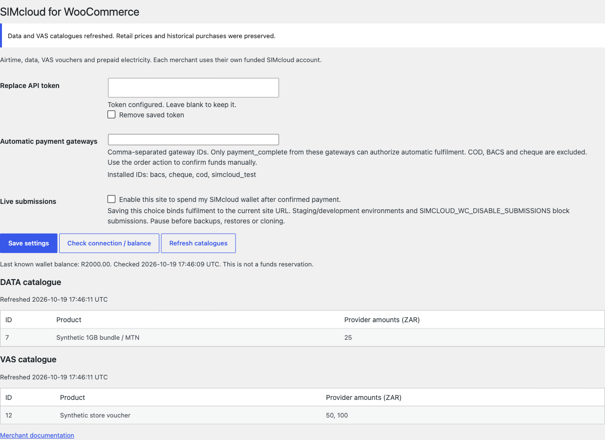

# Install SIMcloud for WooCommerce in WordPress

This illustrated guide takes you from the GitHub download to a configured WooCommerce prepaid store. It covers **airtime, data bundles, VAS vouchers and prepaid electricity** in **v0.2.0 (prerelease)**.

**Screenshot context:** actual WordPress 7.1.3 and WooCommerce 11.2.1 screens. The base upload/activation images were captured with v0.1.0 on 19 October 2026, so their filename is the earlier ZIP; use the v0.2.0 filename in the instructions. The updated import screens are in the [data-import guide](data-product-import.md). Wallet balance, catalogues and transactions are synthetic. The example gateway `simcloud_test` exists only in the local test environment. Your versions, products and gateway IDs may differ. No live supplier purchase was performed. Click any image to enlarge it on GitHub.

## Before you start

- An individual WordPress site with administrator access, **WordPress 6.8.3+**, **PHP 8.2+** and **HTTPS**.
- **WooCommerce 10.0.4+**, installed and activated. Complete its store setup and use **South African rand (ZAR)**.
- Your own [SIMcloud account](https://simcloud.co.za/), API token and sufficient wallet funds for purchases.
- A configured WooCommerce payment gateway and working WordPress/Action Scheduler background jobs.
- A staging/review process and your own customer terms, support, privacy and refund policies.

Use a backup before installing on an existing store. This release does not support network activation, mixed prepaid/other baskets, variable products, subscriptions or multi-currency. Minimum requirements do not mean every combination has been tested; see the [verified matrix](verification.md).

## 1. Download the installable plugin ZIP

Open the [v0.2.0 release](https://github.com/ErikThiart/simcloud-woocommerce/releases/tag/v0.2.0) and expand **Assets**. Download **`simcloud-woocommerce-0.2.0.zip`**. The adjacent `.sha256` file is available for checksum verification.

GitHub's **Source code (zip)** and **Source code (tar.gz)** downloads are source archives. The named plugin ZIP is the packaged WordPress installation file. There is no need to unzip it before uploading.

## 2. Open Upload Plugin in WordPress

Sign in to your WordPress administration area. Open **Plugins → Add New Plugin** and click **Upload Plugin**. Some WordPress versions label the menu **Add New**.

## 3. Select the ZIP and install

Click **Choose File**, select **`simcloud-woocommerce-0.2.0.zip`**, then click **Install Now**. Confirm the selected filename matches the release asset.

## 4. Activate the plugin

After WordPress reports **Plugin installed successfully**, click **Activate Plugin**. WooCommerce must already be active. Activation creates the plugin's site-prefixed fulfilment table and leaves **live submissions disabled**.

## 5. Open WooCommerce → SIMcloud

The new **SIMcloud** submenu appears under **WooCommerce**. Open it. This is where you connect your account, check balance, refresh catalogues and control fulfilment.

## 6. Save your API token and check the connection

In your SIMcloud account, open **API → Get Token**. Copy your token into **Replace API token** in WordPress, then **Save settings**. The saved token is never redisplayed. Leaving the replacement field blank keeps the existing token.

Click **Check connection / balance**. A successful response displays the last known balance and time. This is a read-only check; it does not reserve funds or make a recharge. Customer payments do not automatically fund your SIMcloud wallet.

Keep tokens out of screenshots, issues, browser scripts and Git. Managed hosts may instead supply `SIMCLOUD_WC_API_TOKEN` in private server configuration; it takes precedence over the saved option. See [credential handling](security-and-privacy.md).

## 7. Refresh catalogues and create your products

Click **Refresh catalogues / import data**. This automatically publishes missing data-bundle products using the API amount as the initial WooCommerce regular retail price. Existing products and prices are preserved. See [automatic data-product import](data-product-import.md). The data and VAS tables show currently available provider products, IDs and amounts. Select your own available products; the screenshot's sample IDs and prices are demonstration data.

Review the imported data products, then follow the [four-service product setup guide](product-setup.md) for the other services or manual configuration. Create **simple** products, set the WooCommerce retail price, and configure the SIMcloud fields under **Product data → General**. Valid prepaid configurations become virtual and non-downloadable. Publish only after checking the service, network, catalogue and provider amount.

## 8. Configure payment authorization and scheduled jobs

Your payment gateway must first be set up in **WooCommerce → Settings → Payments**. In **WooCommerce → SIMcloud**, the installed gateway list shows each gateway's actual ID. Enter the IDs permitted to authorize automatic fulfilment, separated by commas.

Use only a gateway that authenticates its payment result and calls WooCommerce's `payment_complete`. A gateway appearing in the list is not proof of compatibility. Test its actual integration. **Do not copy `simcloud_test` from the screenshot**: it is a local demonstration gateway and is not shipped as a customer payment option.

BACS, cheque and COD are excluded from automatic authorization. After funds are actually received, authorized staff use **SIMcloud: confirm received funds and queue** in the order actions dropdown, then click **Update**. See the [staff action screenshot](screenshots.md#staff-confirmation-for-offline-payments).

Check **WooCommerce → Status → Scheduled Actions** for the `simcloud-wc` group. Low-traffic stores should configure a real server cron with their host. See [background jobs](merchant-guide.md#background-jobs) for the runner and polling details.

## 9. Complete acceptance and enable live submissions

Review the [test and acceptance policy](testing.md). Ordinary automated tests use intercepted transport; this project does not provide a SIMcloud sandbox or test wallet. Use a controlled purchase with your own account and agreed recipient/product/amount to confirm your payment gateway, wallet, supplier delivery and customer order view before opening production sales. Live acceptance requires enabling submissions on the controlled production-environment installation.

When ready, deliberately tick **Enable this site to spend my SIMcloud wallet after confirmed payment** under **Live submissions**, then click **Save settings**. This binds fulfilment to the current home URL. The WordPress environment type must be `production`; copied/staging sites and a changed home URL are blocked. The screenshot shows the enabled state only inside a local environment with intercepted API transport.

For a manual-payment acceptance order, verify receipt of funds before using the staff confirmation action. For an online gateway, verify its authenticated payment callback. Then verify scheduled jobs, provider status and delivery. Payment success alone does not establish prepaid delivery.

## After installation

- [Configure airtime, data, VAS and electricity products](product-setup.md).
- [Preview customer checkout and delivered codes](screenshots.md).
- [Learn daily operations and recovery](merchant-guide.md).
- [Resolve setup problems](troubleshooting.md) or [read common questions](faq.md).

## Updates and removal

Updates are distributed through [GitHub Releases](https://github.com/ErikThiart/simcloud-woocommerce/releases); automatic WordPress.org updates are not provided. Back up first, review the [changelog](../CHANGELOG.md), pause submissions and reconcile open purchases before replacing the plugin ZIP. Reactivation stays paused; re-check settings and deliberately re-enable after review.

Deactivation preserves purchase evidence. Uninstall removes saved credentials/settings/cache and jobs while retaining orders, snapshots and fulfilment records. A token constant must be removed separately. Read [removal, restores and privacy](merchant-guide.md#removal-restores-and-privacy) before uninstalling or restoring a backup.

[← Documentation index](README.md) · [Next: product setup →](product-setup.md)
