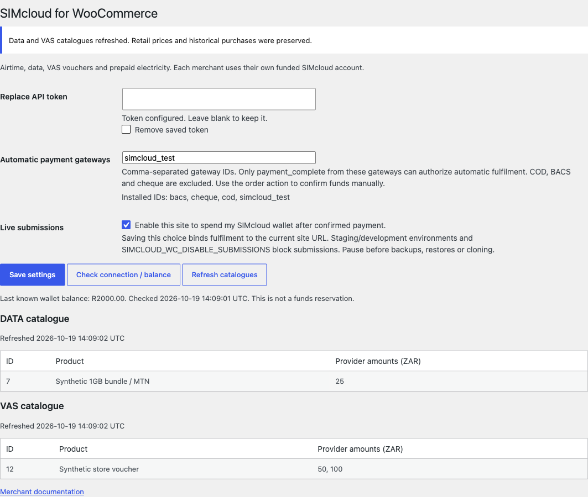

# Merchant guide

This guide describes version 0.1.0. Start with a staging installation using mocked transport, then arrange a controlled live purchase with your own funded SIMcloud account. The project does not provide a SIMcloud sandbox or test wallet.

## Installation

Use WordPress 6.8.3+, WooCommerce 10.0.4+, PHP 8.2+ and HTTPS. Set the store currency to ZAR. Download a tagged ZIP from [Releases](https://github.com/ErikThiart/simcloud-woocommerce/releases), upload it through Plugins, and activate it on the individual site. Network activation is rejected.

The plugin creates a site-prefixed `simcloud_wc_fulfilments` table. Activation leaves live submissions disabled. It does not modify the SIMcloud backend or create a SIMcloud account.

## Credentials and connection

Open **WooCommerce → SIMcloud**. Obtain your token through your SIMcloud account's **API → Get Token** screen, paste it into **Replace API token**, and save. A blank field keeps the existing token; the remove checkbox deletes the saved token. Its value is never redisplayed.

For managed hosting, define `SIMCLOUD_WC_API_TOKEN` in server configuration. The constant takes precedence over the saved option. Do not put a real token in a Git repository or frontend script. WordPress database storage is not advertised as encrypted storage.

Use **Check connection / balance** after saving. It performs a GET, displays the last known wallet balance and timestamp, and clears an authentication pause only after a valid response. The balance is not reserved. Customer payment settlement does not automatically fund your SIMcloud wallet.

## Catalogue and products

Use **Refresh catalogues** to load current data and VAS products. Cached results expire after 15 minutes; validation refreshes expired data through the API. The settings tables show product IDs, descriptions and available provider amounts.

Create a **simple product** and open **Product data → General**:

| Field | Airtime | Data | VAS | Electricity |
| --- | --- | --- | --- | --- |
| Service | Airtime | Data | VAS voucher | Electricity |
| Mobile network | Required | Required | Unused | Unused |
| Provider amount | R2–R999 | Exact catalogue amount | Available denomination | Whole rand R55–R1000 |
| Catalogue product | Unused | Required data product | Required VAS product | Unused |

The plugin makes a valid configured product virtual and non-downloadable. Set its regular/sale retail price separately. A coupon or tax change never changes the provider amount. Data is selected by network and amount in the provider create API; ambiguous catalogue mappings are rejected rather than silently substituted.

Electricity's provider amount includes the SIMcloud fee, so it is not a promise that the entire amount becomes electricity units. The WooCommerce retail price can differ. Confirm your descriptions, pricing, tax treatment and refund policy for all four services.

Customers enter recipient numbers on the product page. Electricity also requires a meter number. The plugin checks recipient network or meter support before purchase and again before submission. VAS codes are delivered to the purchaser's order page and do not require a mobile number. Each line has quantity one. Use separate lines for different recipients. Shop buttons open the product details rather than making a quick purchase without recipient information.

## Payments and enabling fulfilment

In SIMcloud settings, list the IDs of gateways permitted to authorize automatic fulfilment. The page lists installed gateway IDs. A gateway must call WooCommerce's `payment_complete` after authenticating its payment result; the plugin does not independently integrate with each payment provider.

COD, BACS and cheque are excluded from automatic authorization. After funds are actually received, an authorized staff member can choose **SIMcloud: confirm received funds and queue** in the order's action dropdown. That records the staff user and places an eligible order in processing. This action is an explicit financial confirmation; do not use it merely because the customer reached the thank-you page.

Enable **Live submissions** deliberately and save. This binds fulfilment to the current home URL. The site must have the WordPress production environment type. Set `SIMCLOUD_WC_DISABLE_SUBMISSIONS` to `true` to pause both submission and provider polling; queued records are preserved. Resuming does not repeat any recorded attempt. The watchdog requeues unattempted ready records safely.

## Background jobs

WooCommerce Action Scheduler runs `simcloud_wc_submit`, `simcloud_wc_poll` and a five-minute `simcloud_wc_watchdog` in group `simcloud-wc`. Inspect **WooCommerce → Status → Scheduled Actions** and the `simcloud-woocommerce` log source. A real server cron is recommended for low-traffic stores. Configure it using your host's supported WordPress cron runner; for WP-CLI installations a typical command is `wp cron event run --due-now --path=/absolute/path/to/wordpress` every minute. Verify the exact PHP and WordPress paths with your host.

Polling starts after 30 seconds, then backs off through one, two and five minutes, with a maximum 16 observations or one-hour observation window. This cadence is not a delivery guarantee. Missed or ambiguous delivery goes to review with its request ID retained.

## Delivery and exceptions

The order view shows a separate state for every prepaid line. Payment receipt and delivery are separate. A prepaid-only order completes after every line has confirmed delivery. VAS completion also requires voucher codes; electricity completion requires token information.

Codes appear in the authorized order details, including guest access through WooCommerce's private order-key link. Treat those links as bearer credentials. Codes are not placed in generic order metadata, email bodies or operational logs. Staff can see provider IDs, correlation references, timestamps and redacted diagnostics.

Use **SIMcloud: refresh identified provider requests** to schedule GET status checks. It cannot submit a new purchase. A request with no returned provider ID requires reconciliation through the private SIMcloud support channel. There is no automatic retry, automatic refund or resubmit button. See [recovery](order-lifecycle.md).

## Troubleshooting

| Symptom | Action |
| --- | --- |
| Product cannot be purchased | Check live enablement, token/auth pause, production environment, URL binding, product type and currency |
| Payment received but not queued | Verify the allowed gateway and actual payment confirmation; use staff confirmation only for received funds |
| Bundle/denomination unavailable | Refresh catalogue; update the product without changing historical orders |
| Meter cannot be confirmed | Check the meter and retry validation later; unknown support is not permission to purchase |
| Long-running delivery | Inspect saved provider ID, scheduled jobs and latest status; contact SIMcloud privately |
| Timeout or duplicate conflict | Reconcile the original attempt; never solve it by blindly buying again |
| Wallet insufficient | Fund the account and investigate the affected purchase; funding does not automatically repeat it |

## Removal, restores and privacy

Pause before backup restore or cloning. A copied site URL is blocked by the saved binding, but a restored database at the same URL cannot be detected reliably. Reconcile all open purchases before resuming. Do not copy live credentials to staging.

Deactivation pauses fulfilment and removes plugin jobs while preserving evidence. Reactivation stays paused. Uninstall deletes saved credentials/settings/cache and jobs, while retaining orders, snapshots and fulfilment records; a token constant needs separate removal from configuration.

The plugin adds suggested WordPress privacy text, exports prepaid purchase details, and reports retained records to the eraser. Erasure does not silently delete unresolved delivery, financial evidence or redeemable codes. Set a justified retention policy and review removal privately. See [security and privacy](security-and-privacy.md) and [support](../SUPPORT.md).
