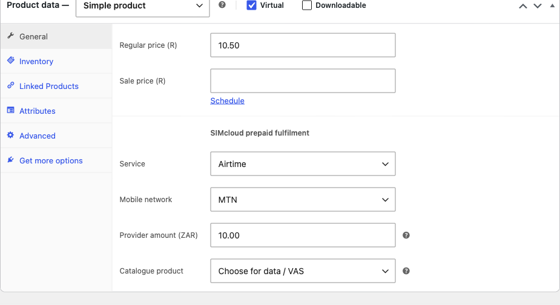
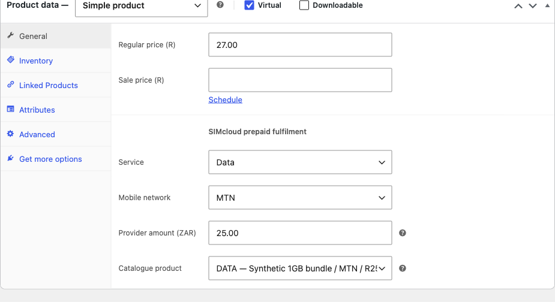
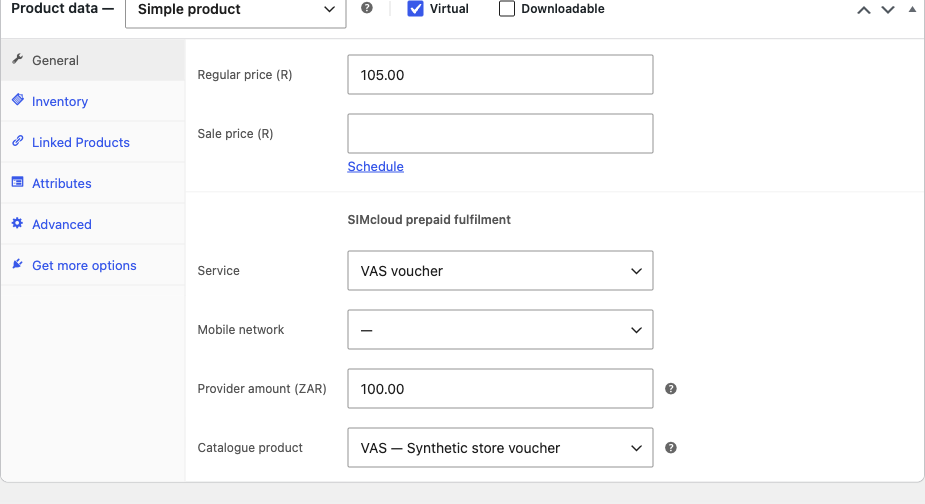
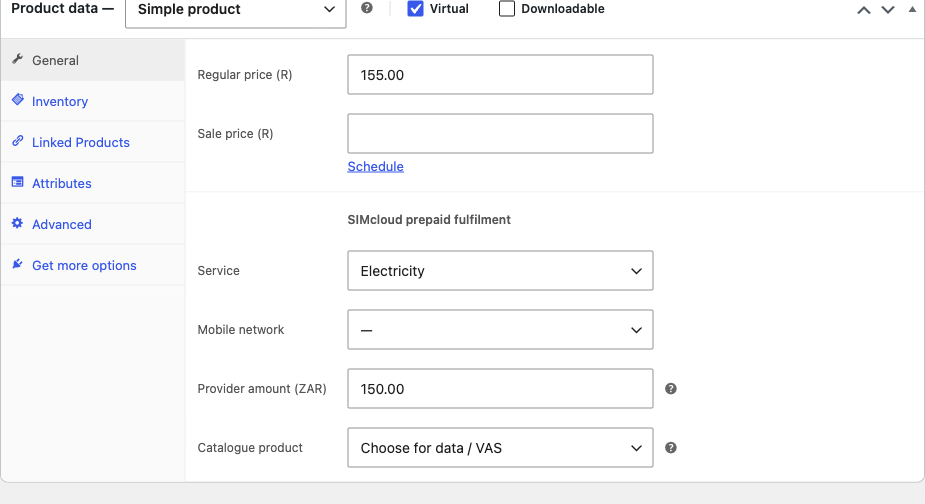

# Set up airtime, data, VAS and electricity products in WooCommerce

Configure each service in **Products → Add new product → Product data → General**. This guide describes **v0.2.0 (prerelease)**. Finish the [installation and connection steps](installation.md) first.

The manual-configuration screenshots below were captured with v0.1.0 and show real saved WooCommerce product settings with **synthetic provider catalogue data**. Names, IDs, amounts and markups are examples, not current SIMcloud offers or recommended selling prices. Refresh your own catalogue and confirm your commercial terms.

## Settings shared by all four services

1. Choose **Simple product** and enter a clear customer-facing name and description.
2. Set the WooCommerce **Regular price** (and sale price, if applicable). This is your retail selling price.
3. Select **SIMcloud service** and set the **SIMcloud provider amount**. This is the amount sent to the provider, separate from the retail price, tax and coupons.
4. Set the network and catalogue product where the service requires them, then save/publish.

A valid SIMcloud product becomes virtual and non-downloadable. Use quantity **one per recipient line**; separate recipients require separate lines. Keep prepaid products in a prepaid-only basket. Do not use variable products, bundles, subscriptions or a downloadable file to deliver codes.

| Service | Network | Catalogue | Provider amount | Customer input |
| --- | --- | --- | --- | --- |
| Airtime | Required | Unused | R2–R999 | South African recipient mobile number |
| Data | Required | Current data product | Exact catalogue amount | South African recipient mobile number |
| VAS voucher | Unused | Current VAS product | Available denomination | No mobile or meter number |
| Electricity | Unused | Unused | Whole rand R55–R1000 | Recipient mobile number and meter number |

## Airtime product

Example: **MTN R10 Airtime**, retail **R10.50**, service **Airtime**, network **MTN**, provider amount **R10**. Leave catalogue selection unused. Describe the actual recharge amount in the product name so customers can distinguish it from your selling price.

The customer enters a South African mobile number on the product page. The plugin validates the number/network before purchase and checks again before submission. Do not infer a ported number's network from its prefix alone. [See the customer form](screenshots.md#customer-recipient-and-meter-entry).

## Data bundle product

**Automatic setup:** click **Refresh catalogues / import data** in WooCommerce → SIMcloud. Missing data products are published with network, catalogue ID and provider amount configured, using the API amount as their initial regular retail price. See [automatic import with screenshots](data-product-import.md). Existing products and prices are preserved.

You can still configure a data product manually using the fields below.

Click **Refresh catalogues / import data** in SIMcloud settings first. Choose an available data product with the matching network and exact provider amount.

The local example is **MTN 1GB Data (Demo)**, retail **R27**, network **MTN**, provider amount **R25**, catalogue **`data:7`**. These are synthetic values: they do not establish that this bundle or price is available to your account.

Use the current catalogue description to explain size and validity. Data creation uses network and amount in the current provider contract; ambiguous mappings are rejected. If the catalogue changes, update the product for future purchases and preserve existing order snapshots. Do not silently replace a customer's bundle.

## VAS voucher product

Refresh catalogues, choose **VAS voucher**, select the VAS product and set one of its available provider denominations. Network is unused.

The local example is **R100 Store Voucher (Demo)**, retail **R105**, provider amount **R100**, catalogue **`vas:12`**. Both the catalogue and delivered code are synthetic.

Customers do not enter a recipient mobile number for VAS. Voucher code(s) appear in the purchaser's authorized order details after confirmed delivery. Describe redemption rules and expiry from the actual provider offer. Never put a real redeemable code in a public screenshot or product description. [Preview voucher delivery](screenshots.md#vas-voucher-delivery).

## Prepaid electricity product

Choose **Electricity**, set a whole-rand provider amount between **R55 and R1000**, and leave network/catalogue unused.

The local example is **R150 Prepaid Electricity**, retail **R155**, provider amount **R150**.

**The provider amount includes the SIMcloud fee.** Do not promise that R150 becomes R150 of electricity or a fixed number of units. Explain your retail charge and the provider fee clearly. The customer supplies a recipient mobile number and meter number; the meter must pass validation before purchase. Token(s) and units appear after confirmed delivery. [Preview electricity delivery](screenshots.md#electricity-token-delivery).

## Check the saved product before selling

Open the published product and confirm the description, retail price, service amount and input fields. Verify network/meter validation, checkout and authorized delivery in your acceptance process. Checkout success alone is not a provider delivery test. Use the [installation acceptance steps](installation.md#9-complete-acceptance-and-enable-live-submissions) and [troubleshooting guide](troubleshooting.md) for failures.

[← Installation](installation.md) · [Screenshot gallery →](screenshots.md) · [Documentation index](README.md)
