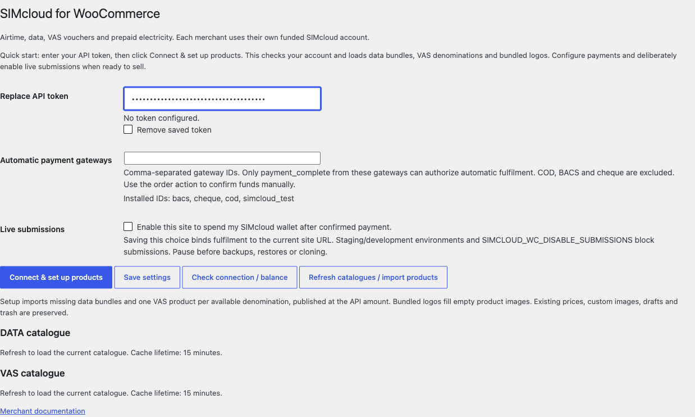
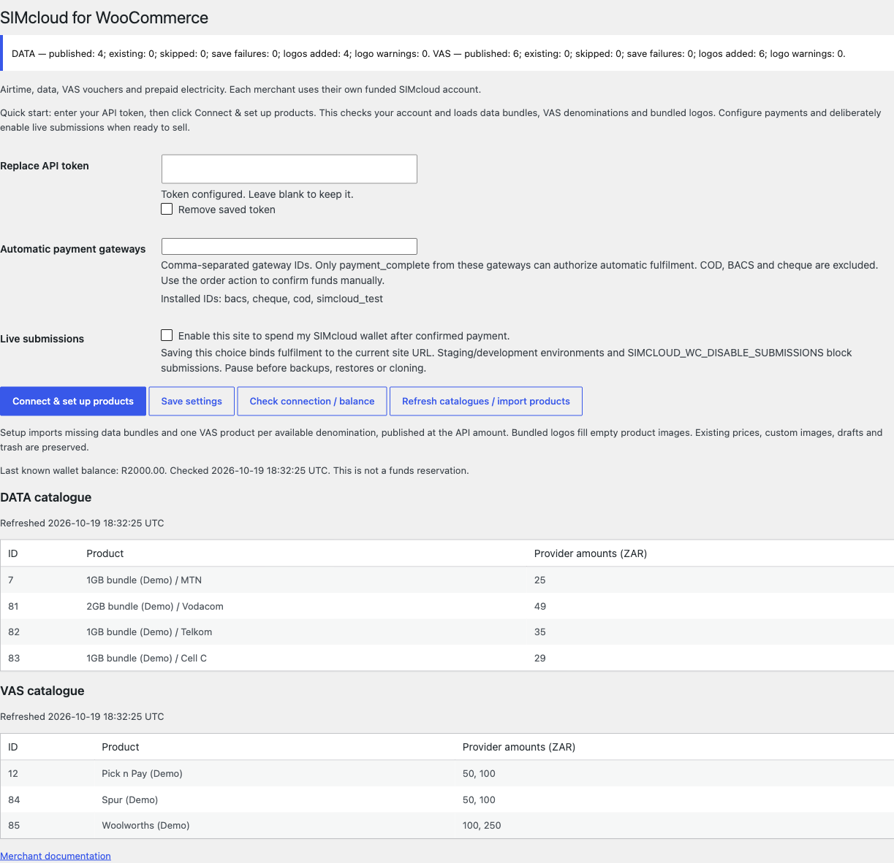
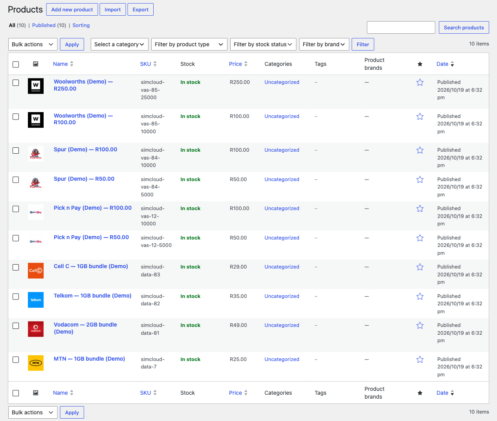
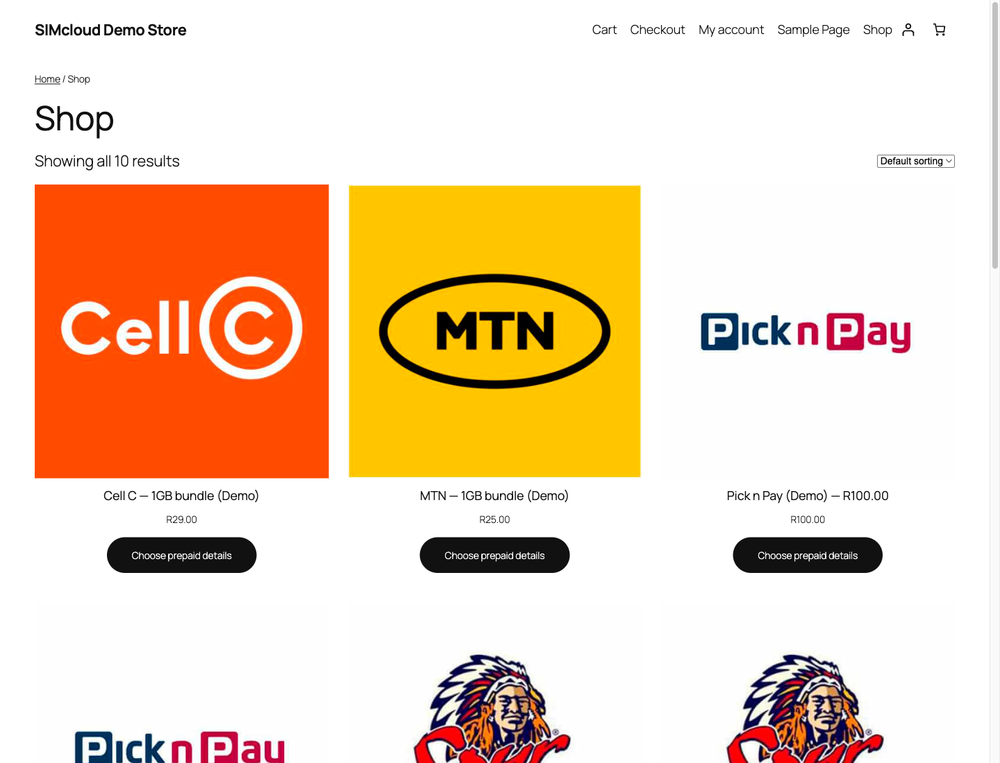

# One-click SIMcloud product setup for WooCommerce

Version **0.3.0 (prerelease)** connects your account, creates data-bundle and VAS-voucher products, and gives them the correct bundled logos. Once WordPress and WooCommerce are installed, entering your token and pressing one setup button replaces the separate save, connection-check and catalogue-import steps.

## 1. Install the plugin

Use WordPress 6.8.3+, WooCommerce 10.0.4+, PHP 8.2+, HTTPS and a **ZAR** store. Download [simcloud-woocommerce-0.3.0.zip](https://github.com/ErikThiart/simcloud-woocommerce/releases/download/v0.3.0/simcloud-woocommerce-0.3.0.zip), then **Plugins → Add New Plugin → Upload Plugin → Install Now → Activate**. On the Plugins page, **Set up SIMcloud** opens the settings. The [illustrated installation guide](installation.md) explains the upload screens.

## 2. Enter your token and click Connect & set up products

Open **WooCommerce → SIMcloud**, enter the token from your SIMcloud account's **API → Get Token** screen, and click **Connect & set up products**. Your staff user needs WooCommerce management, product editing and Media Library upload permissions.

The button saves the settings, verifies the account using the balance endpoint, reads both current catalogues and populates the products. An invalid token stops setup before import. It does not place a prepaid order or spend wallet funds.

## 3. Review the products and their logos

The result shows published/existing/skipped products, save failures, images added and image warnings for each service.

Data bundles become simple virtual products with their network, provider ID and amount configured. Each available VAS denomination becomes its own simple virtual product. New products are published with the **API amount as the initial regular retail price**. The importer reads actual available denominations; it does not invent products or prices.

The ZIP contains **23 original JPEGs downloaded from SIMcloud: four network logos and 19 VAS logos**. The appropriate image is copied into the local Media Library and assigned as the featured image. Products sharing a brand reuse one attachment. Thumbnail sizes and image URLs use native WordPress/WooCommerce handling.

Existing merchant prices, copy, SKUs, custom images and publication states stay intact. Empty images on matching existing data/VAS products receive their defaults; drafts stay drafts and trash is not restored. Manually configuring an airtime/data/VAS product also assigns its default image if the image field is empty. You can replace any default through the normal product-image editor.

The storefront uses local uploads rather than hotlinking to SIMcloud:

## 4. Configure payments and enable live sales deliberately

Set up your WooCommerce payment gateway, select its allowed ID in SIMcloud settings, verify scheduled jobs and follow the [controlled acceptance process](testing.md#live-acceptance-boundary). When ready, deliberately enable **Live submissions** and save. Product setup leaves that choice unchecked on a new installation.

Customer payments settle through your gateway; provider purchases use your funded SIMcloud account. Setup cannot supply a merchant payment account, API credentials or prepaid value. Airtime and electricity still use the [simple-product setup](product-setup.md), so merchants choose their own denominations rather than receiving invented presets.

## Refreshing and fixing problems

Use **Refresh catalogues / import products** to add missing data/VAS products and fill empty default images. Repeat setup does not duplicate products or brand attachments. It does not reprice, delete or unpublish existing products. Unknown future brands produce an image warning and require an updated bundled asset or your own appropriate image. Check Media Library upload permissions if image creation fails. External catalogue image URLs are never downloaded at runtime.

See [import rules](data-product-import.md), [troubleshooting](troubleshooting.md), [bundled asset provenance](../assets/images/NOTICE.md) and the [image manifest](../assets/images/sources.json).

**Screenshot context:** actual WordPress 7.1.3 / WooCommerce 11.2.1 with the packaged v0.3.0 plugin, captured 19 October 2026. A fresh synthetic store created four data products and six VAS denominations using seven shared image attachments. All ten product images loaded from local uploads, a repeat setup created zero duplicates and the tested 390-pixel storefront had no horizontal overflow. Catalogue items, amounts and balance are demonstration fixtures, not current provider offers. The logos are the original downloaded SIMcloud assets. No paid supplier purchase was made.

[← Documentation index](README.md) · [Full installation](installation.md) · [Product setup](product-setup.md)
