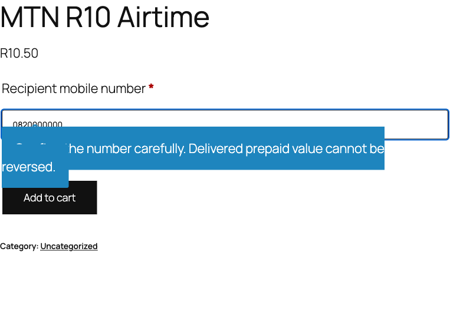
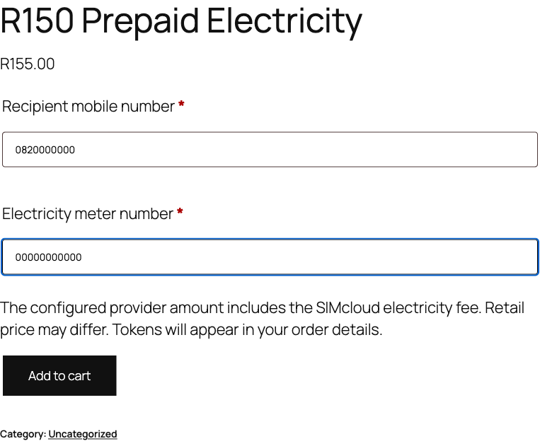
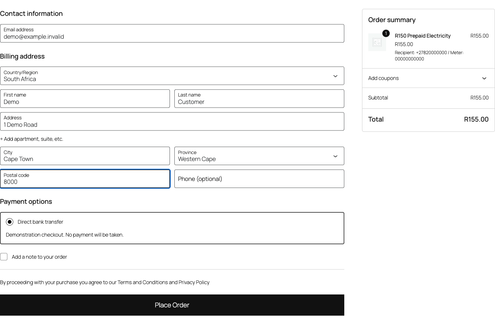
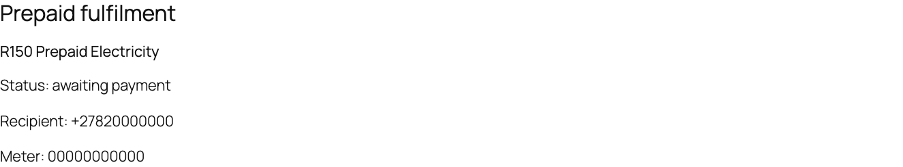
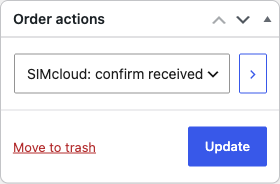
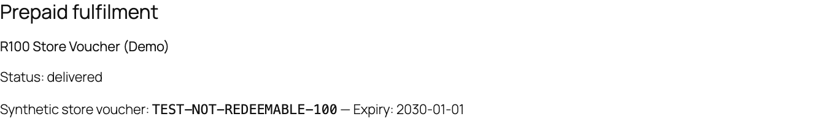

# SIMcloud WooCommerce screenshots

Preview the actual WordPress administration screens and customer experience for the airtime, data, VAS voucher and prepaid electricity plugin. For v0.2.0, see the [automatic data-product import screenshots](data-product-import.md). The gallery below records v0.1.0. Follow the [illustrated installation guide](installation.md) for the full upload-to-activation sequence and [product setup](product-setup.md) for all four service configurations.

**Capture context:** v0.1.0 prerelease, WordPress 7.1.3, WooCommerce 11.2.1, captured 19 October 2026. These are real interfaces in a local demonstration store. Balance, catalogue, phone/meter details, payments and provider responses are synthetic. Test codes cannot be redeemed. No live wallet was charged. The capture environment is described in [image provenance](images/README.md). Click images to view full size.

## Account settings and connection

Save an API token without redisplaying it, check the connection and view the last known wallet balance. This example balance is synthetic.

## Data and VAS catalogue refresh

Provider IDs, descriptions and available denominations help merchants configure products. The example products below are synthetic and must not be copied as current offers.

## Customer recipient and meter entry

An airtime product requests the recipient's mobile number. Data uses the same recipient flow. The screenshot shows a sample airtime product with a separate retail selling price.

Electricity also requests a meter number. Supported-meter validation is required before purchase. These fields contain demonstration values.

## WooCommerce Checkout Blocks

The prepaid line retains its recipient and meter details in checkout. This local example uses direct bank transfer with synthetic billing details. Reaching the confirmation page does not authorize delivery by itself.

## Awaiting payment

The order view shows the prepaid line's fulfilment state separately from the WooCommerce payment state. A bank-transfer order waits for authorized confirmation of actually received funds.

## Staff confirmation for offline payments

After verifying funds were received, authorized staff select **SIMcloud: confirm received funds and queue** in the order's **Order actions** dropdown and click **Update**. The action records the staff user. The screenshot demonstrates the selection; it is not proof of a real payment.

## Electricity token delivery

The authorized order view displays confirmed token information and units. The illustrated token is a non-redeemable test value. Real electricity amounts/units depend on the provider response and fees.

## VAS voucher delivery

Voucher code(s) appear in authorized order details after confirmed delivery. This synthetic code is explicitly non-redeemable.

Real order-key links and redeemable codes are private. Email links direct customers to authorized order details without embedding codes in the email body. See [security and privacy](security-and-privacy.md).

[← Documentation index](README.md) · [Product setup](product-setup.md) · [Troubleshooting](troubleshooting.md)
