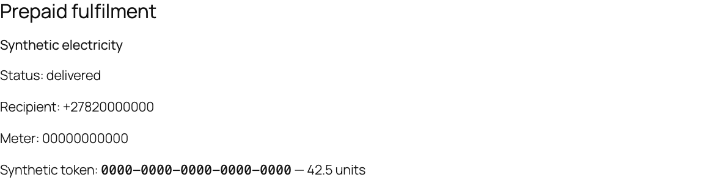

# Verification evidence — version 0.1.0

Review date: 19 October 2026. This file records evidence without claiming unperformed provider tests.

## Local integration

WordPress 7.1.3, WooCommerce 11.2.1, PHP 8.4.17 and MariaDB 13.0.2 were used in a dedicated local test installation. The four-service integration suite passed 75 assertions, including actual classic checkout and Checkout Blocks Store API order creation. Two separate WordPress/PHP processes produced exactly one atomic submission-claim winner. Interrupted-attempt and deactivation/reactivation/uninstall checks also passed.

Tests used intercepted HTTP responses and synthetic payment collection. They exercised real WooCommerce products, orders, sessions, API routes, database constraints and job registration. No live merchant token or paid recharge was used.

## Additional evidence

The [three-job CI matrix passed](https://github.com/ErikThiart/simcloud-woocommerce/actions/runs/39266219835) for PHP 8.2/8.4/8.5, legacy/HPOS storage and minimum/current WordPress/WooCommerce combinations. Every job passed both the source-checkout tests and installation/testing of the exact release ZIP.

| PHP | WordPress | WooCommerce | MariaDB | Storage | Source and ZIP suite |
| --- | --- | --- | --- | --- | --- |
| 8.2.34 | 6.8.3 | 10.0.4 | 11.4.13 | Legacy | 75 assertions each, plus concurrency/lifecycle |
| 8.4.26 | 7.1.3 | 11.2.1 | 11.4.13 | HPOS | 75 assertions each, plus concurrency/lifecycle |
| 8.5.11 | 7.1.3 | 11.2.1 | 11.4.13 | HPOS | 75 assertions each, plus concurrency/lifecycle | The exact runtime ZIP was installed through WordPress and passed the same 75-assertion suite plus concurrent-worker and lifecycle checks.

## Browser validation

A browser completed a classic-checkout VAS purchase using synthetic payment, and a Checkout Blocks electricity purchase using the core BACS gateway followed by explicit staff funds confirmation. Authorized order views displayed the expected non-redeemable test voucher and electricity token/units. A 390-pixel mobile viewport showed no horizontal overflow on the tested order view.

A data product was also saved successfully through the actual WooCommerce product editor with its catalogue mapping preserved. Merchant settings were exercised through WordPress admin: token save/masking, excluded offline gateway filtering, live enablement, balance diagnostics and both catalogue refreshes. These tests used the same intercepted transport and made no paid requests.

## Static security checks

WordPress Plugin Check 2.1.0 security-category checks against the packaged runtime returned **zero errors** and 14 warnings. All warnings concern direct database access and lack of caching in the plugin-owned ledger/watchdog. These queries are deliberate: state claims and recovery require fresh database state, use prepared parameters/identifiers and do not access WooCommerce order tables directly. This check is not an independent security audit.

## Limits

This is not an independent security audit, a certification, a complete gateway compatibility matrix, or proof of live SIMcloud/supplier delivery. Merchant-owned controlled acceptance remains required before production sales. WordPress.org submission and current applicable service terms/privacy review are separate release/distribution steps.
